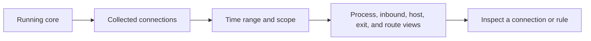

import { Aside, Badge } from "@astrojs/starlight/components";

The dashboard gives you a configurable runtime overview. Traffic analysis helps answer where traffic came from, which process created it, and how it was routed. <Badge text="Requires collected traffic" variant="note" />

## Arrange dashboard widgets

1. Open **Dashboard** from the main navigation.
2. Choose **Edit Widgets** from the dashboard action or its context menu.
3. Open **Add Widgets**, then add the information you want to keep visible.
4. While editing, drag widgets to rearrange them and resize them where the grid allows.
5. Finish editing when the dashboard is arranged the way you want.

Available widgets include traffic totals, active connections, memory, proxy and core shortcuts, subscription usage, recent traffic, and traffic summaries by source, inbound, destination, exit, or rule. Some widgets need a running core and recent traffic before they can show data.

## Find a traffic source or destination

1. Open **Traffic** from the main navigation.
2. Start with the overview, then choose **Top processes**, **Top inbounds**, **Top hosts**, **Top exits**, or **Top devices**.
3. Select an item to focus the report on it. Open **Connection paths** to see how traffic moves between stages, or **Geography** to inspect location summaries.
4. If you are investigating one connection, continue to **Connections** or **Rules** and compare its destination, selected rule, and proxy route.

Traffic reports depend on data collected by the running core and on the selected time range, scope, and filters. Reports aggregate traffic into minute- or hour-sized buckets; a sliding time range can include the bucket at its boundary, so it may not represent an exact instant. Profile attribution is recorded when a connection is first observed; a connection that remains open after switching profiles keeps its original attribution. Retention settings can limit the history available to a report.

## Filter the report

Use **Scope** to show all, active, or closed connections. Choose whether rankings measure **Bytes** or **Connections**, then select a time range: 1 hour, 6 hours, 24 hours, 7 days, 30 days, or all retained data. A range can be unavailable when the configured retention period does not cover it.

<Aside type="caution" title="Changing retention deletes older records">
  In **Settings → Nyanpasu Settings**, shortening **Traffic History Retention** immediately deletes
  records older than the new limit, and the deletion cannot be undone. Traffic records include
  visited hostnames.
</Aside>

<Aside type="note" title="Geography is an estimate">
  Geography uses the address a connection dialed when available and may use local DNS results
  otherwise. A proxy may resolve the destination differently, and proxy exits are not geolocated.
  Map routes are schematic connections between regions, not measured network paths; the view draws
  at most 32 routes.
</Aside>

For a live connection check, see [Make your first connection](../first-connection). To change which configuration is active, see [Profiles and subscriptions](../profiles-and-subscriptions).
