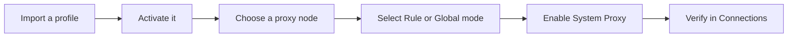

import { Badge } from "@astrojs/starlight/components";

Clash Nyanpasu manages Clash-compatible proxy profiles and includes several core engines. Choose a core that supports the fields and features in your configuration; you also need a working profile and proxy.

<Badge text="Beginner guide" variant="tip" /> <Badge text="System Proxy" variant="note" />

## Before you begin

- [Install Clash Nyanpasu](./install) and open the app.
- Make sure your computer has an internet connection.
- Get either a subscription URL from your proxy provider or a local Clash-compatible YAML configuration (`.yaml` or `.yml`) that contains at least one proxy.

If you are unsure which engine supports your configuration, read [Choose and manage a core](../cores-and-compatibility) before importing it.

## 1. Import a profile

Open **Profiles** in the main navigation, then open the proxy profile list.

- **Subscription:** Paste the subscription URL into the quick import field at the top of the page, then click the download button.
- **Local configuration:** Click **Import Profile** in the lower-right corner, choose **Local**, keep **Single** selected, choose your `.yaml` or `.yml` file, and click **Submit**.

Wait for the new profile to appear in the list. A subscription URL must be provided by your service; an account sign-in page or an individual proxy link is not a subscription.

## 2. Activate the profile

On the profile card, click **Activate Profile**. After activation, the card is highlighted and no longer shows the activation button. The app applies that configuration to the running core.

## 3. Choose and test a proxy

Open **Proxies**, choose a group used by your profile, and click a proxy node to select it. Some groups choose a node automatically and do not allow manual selection; use a group that supports choosing a node if needed.

Click the lightning button on a node to run its latency test. Wait for a delay result, then choose a node that responds. The test checks the node against the profile's latency test URL; it does not confirm that every destination will be routed through that node.

If the routing mode is **Direct**, open **Proxy Settings** from the app's settings menu and switch to **Rule** or **Global**. Direct mode sends traffic without using a proxy.

## 4. Enable System Proxy

Open **Settings > System Settings** and click **System Proxy**. You can also toggle **System Proxy** under **Proxy Settings** in the app's settings menu. Confirm that the control shows System Proxy as active.

System Proxy configures your operating system's proxy settings. It applies to apps that use those settings; some apps may need to be restarted, and some do not follow them. For details or the TUN alternative, see [System Proxy and TUN](../system-proxy-tun).

## 5. Verify the connection

Open a browser or another app that uses System Proxy, then visit a destination that your profile routes through a proxy. In **Connections**, find that request and check that its proxy chain includes the group or node you selected. In Rule mode, some destinations may be routed directly, so check the connection's chain as well as whether the page loads.
