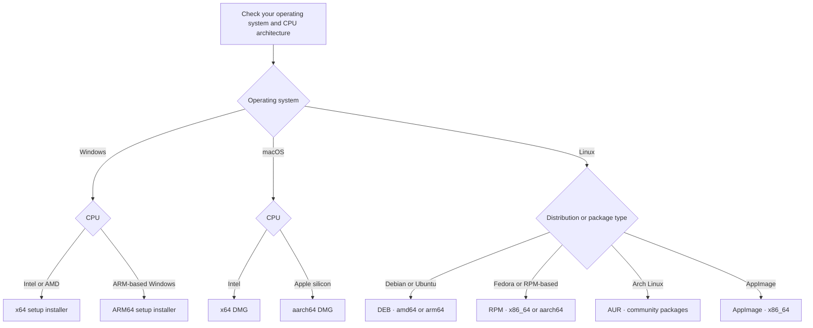

import { Badge, Steps, Tabs, TabItem } from "@astrojs/starlight/components";

<Badge text="Windows · x64 / ARM64" />
<Badge text="macOS · Intel / Apple silicon" />
<Badge text="Linux · DEB / RPM / AppImage" />
<Badge text="Native multi-core support" variant="success" />

Clash Nyanpasu supports Windows 10 and later, macOS 12.6 and later, and Linux with `glibc >= 2.39`. Choose the package for your device from the official [releases](https://github.com/LibNyanpasu/clash-nyanpasu/releases) page; package types and architectures vary by release.

:::note[Architecture names]

<code>x64</code>, <code>amd64</code>, and <code>x86_64</code> refer to 64-bit Intel/AMD builds.
<code>ARM64</code> and <code>aarch64</code> refer to 64-bit Arm builds, including Apple silicon and
supported Windows or Linux devices. Only these 64-bit architectures are supported; 32-bit and older
Arm targets are unavailable.

:::

:::caution[Archived and unsupported versions]

Clash Nyanpasu 1.6.x and earlier are fully archived and unsupported. They receive no maintenance or fixes; do not use them for new installations.

:::

## Choose the right package



<Steps>

1. **Check your CPU architecture.** On Windows, open **Settings → System → About** and read **System type**. On macOS, open **Apple menu → About This Mac**. On Linux, run `uname -m` in a terminal.
2. **Match the asset name.** `x64`, `amd64`, and `x86_64` refer to 64-bit Intel/AMD builds. `ARM64` and `aarch64` refer to 64-bit Arm builds. The release page may not offer every package type for every architecture.
3. **Install the package and continue to [your first connection](./first-connection).** If you are using a Linux package, also read the notes for that package below.

</Steps>

:::note[Built-in proxy cores]

Clash Nyanpasu natively supports the Clash Premium, Mihomo, Clash Rust, and Meow core families, with stable and Alpha choices where available. Official release packages bundle the supported core programs. A configuration may use features that are not implemented by every core; see [Core selection and compatibility](./cores-and-compatibility).

:::

## Windows

<Badge text="Windows 10 or later" />
<Badge text="x64" />
<Badge text="ARM64" />

Download the installer ending in `_x64-setup.exe` for most Intel/AMD PCs or `_arm64-setup.exe` for Windows on ARM.

:::note[WebView2 prerequisite]

The standard installer uses the Microsoft WebView2 bootstrapper. If the WebView2 Runtime is missing, the installer can set it up; this may require an internet connection. You can also install the [WebView2 Runtime from Microsoft](https://developer.microsoft.com/en-us/microsoft-edge/webview2) first.

If you need the runtime included with the app, choose the larger installer containing `fixed-webview` in its name, such as `_fixed-webview-x64-setup.exe` or `_fixed-webview-arm64-setup.exe`.

:::

### Portable archive

Windows releases also provide `_x86_64_portable.zip` and `_aarch64_portable.zip`. Extract the archive and run the app executable. Fixed-WebView portable archives are also available and include the WebView2 runtime.

:::caution[Portable package notes]

The standard portable archive does not contain WebView2, so the runtime must already be installed. Portable settings and data are stored under `.config/` and `.data/` beside the extracted app; keep that folder writable and together when moving or backing up the app.

The archive includes <code>nyanpasu-service.exe</code>; installing or starting the service requests elevated authorization and registers a Windows service. When the app starts, its deep-link handler also registers the <code>clash:</code> and <code>clash-nyanpasu:</code> URL schemes for the current user, so portable mode can still make these system changes. Windows system notifications are shown as app dialogs in portable mode. Portable packages do not receive the app's in-app application updates, so install a newer portable archive manually when you update.

:::

## macOS

<Badge text="macOS 12.6 or later" />
<Badge text="Intel · x64" />
<Badge text="Apple silicon · aarch64" />

Download the `.dmg` ending in `_x64.dmg` for an Intel Mac or `_aarch64.dmg` for an Apple-silicon Mac. Open the disk image and drag Clash Nyanpasu to **Applications**. If installation fails, see the [FAQ](../others/faq).

## Linux

Official Linux package availability depends on the release. Current package families include DEB for `amd64` and `arm64`, RPM for `x86_64` and `aarch64`, and an `amd64` AppImage. The AppImage is not currently published for ARM64.

<Tabs>
  <TabItem label="Debian / Ubuntu · DEB">

Download the `.deb` ending in `_amd64.deb` or `_arm64.deb`, then install it from the download directory:

```bash
sudo apt install ./Clash.Nyanpasu_*_amd64.deb
```

For an ARM64 system, use:

```bash
sudo apt install ./Clash.Nyanpasu_*_arm64.deb
```

The wildcard assumes that only one matching release package is in the current directory.

  </TabItem>
  <TabItem label="Fedora · RPM">

Download the `.rpm` ending in `.x86_64.rpm` or `.aarch64.rpm`, then install it with DNF:

```bash
sudo dnf install ./Clash.Nyanpasu-*.x86_64.rpm
```

For an ARM64 system, use:

```bash
sudo dnf install ./Clash.Nyanpasu-*.aarch64.rpm
```

The wildcard assumes that only one matching release package is in the current directory.

  </TabItem>
  <TabItem label="AppImage">

Download the `.AppImage` ending in `_amd64.AppImage`. After making it executable, you can double-click it in your file manager or launch it from a terminal. In the directory containing the download, run:

```bash
chmod +x ./Clash.Nyanpasu_*_amd64.AppImage
./Clash.Nyanpasu_*_amd64.AppImage
```

The wildcard assumes that only one matching AppImage is in the current directory. To enable launch at login, open **Settings → System → Startup Settings → Start on system startup**.

TUN depends on the selected core and needs suitable network privileges. Use **System Service** to install and start the service with elevated authorization, enable **Service Mode**, then enable TUN; keep the desktop app running as your normal user instead of launching the whole AppImage with <code>sudo</code>. Follow [System Proxy and TUN](./system-proxy-tun) for the steps.

  </TabItem>
</Tabs>

If you encounter another AppImage issue, include your Linux distribution, architecture, app version, and package type when [reporting it](https://github.com/LibNyanpasu/clash-nyanpasu/issues/new).

### Optional AppImage launcher and autostart entry

The built-in login setting is under **Settings → System → Startup Settings → Start on system startup**. If you create a desktop entry manually, keep the AppImage at a fixed absolute path and replace <code>VERSION</code> with its actual filename. A launcher belongs in an <code>applications</code> directory; automatic login uses a separate <code>autostart</code> directory. <code>Autostart=true</code> is not a standard desktop-entry key, and <code>update-desktop-database</code> refreshes the applications directory only. Use either the built-in setting or the manual autostart entry to avoid launching the app twice.

<Tabs>
  <TabItem label="User directories">

Set <code>APPIMAGE_PATH</code> to the absolute path of your AppImage. This example uses the standard hicolor icon directory:

```bash
APPIMAGE_PATH="$HOME/Applications/Clash.Nyanpasu_VERSION_amd64.AppImage"
ICON_DIR="$HOME/.local/share/icons/hicolor/256x256/apps"
APP_DIR="$HOME/.local/share/applications"

chmod +x "$APPIMAGE_PATH"
mkdir -p "$ICON_DIR" "$APP_DIR"
curl -fL "https://raw.githubusercontent.com/libnyanpasu/clash-nyanpasu/main/frontend/nyanpasu/src/assets/image/logo-box.png" -o "$ICON_DIR/clash-nyanpasu.png"

cat > "$APP_DIR/clash-nyanpasu.desktop" <<EOF
[Desktop Entry]
Type=Application
Name=Clash Nyanpasu
Comment=Clash proxy client
Exec="$APPIMAGE_PATH" %U
Icon=clash-nyanpasu
Terminal=false
Categories=Network;
EOF

update-desktop-database "$APP_DIR"
```

For automatic login, create a separate entry in the user autostart directory:

```bash
APPIMAGE_PATH="$HOME/Applications/Clash.Nyanpasu_VERSION_amd64.AppImage"
AUTOSTART_DIR="$HOME/.config/autostart"
mkdir -p "$AUTOSTART_DIR"

cat > "$AUTOSTART_DIR/clash-nyanpasu.desktop" <<EOF
[Desktop Entry]
Type=Application
Name=Clash Nyanpasu
Exec="$APPIMAGE_PATH"
Terminal=false
EOF
```

  </TabItem>
  <TabItem label="System directories">

Place the AppImage at a fixed path readable by all users, such as <code>/opt/clash-nyanpasu/</code>, and replace <code>VERSION</code> with its actual filename. The first command copies it from Downloads; change that source path if needed.

```bash
APPIMAGE_PATH="/opt/clash-nyanpasu/Clash.Nyanpasu_VERSION_amd64.AppImage"
ICON_DIR="/usr/share/icons/hicolor/256x256/apps"
APP_DIR="/usr/share/applications"

sudo install -D -m 0755 "$HOME/Downloads/Clash.Nyanpasu_VERSION_amd64.AppImage" "$APPIMAGE_PATH"
sudo install -d "$ICON_DIR" "$APP_DIR"
curl -fL "https://raw.githubusercontent.com/libnyanpasu/clash-nyanpasu/main/frontend/nyanpasu/src/assets/image/logo-box.png" -o /tmp/clash-nyanpasu.png
sudo install -m 0644 /tmp/clash-nyanpasu.png "$ICON_DIR/clash-nyanpasu.png"

sudo tee "$APP_DIR/clash-nyanpasu.desktop" >/dev/null <<EOF
[Desktop Entry]
Type=Application
Name=Clash Nyanpasu
Comment=Clash proxy client
Exec="$APPIMAGE_PATH" %U
Icon=clash-nyanpasu
Terminal=false
Categories=Network;
EOF

sudo update-desktop-database "$APP_DIR"
```

To start it automatically for all users, add a separate entry under <code>/etc/xdg/autostart</code>:

```bash
APPIMAGE_PATH="/opt/clash-nyanpasu/Clash.Nyanpasu_VERSION_amd64.AppImage"
sudo tee /etc/xdg/autostart/clash-nyanpasu.desktop >/dev/null <<EOF
[Desktop Entry]
Type=Application
Name=Clash Nyanpasu
Exec="$APPIMAGE_PATH"
Terminal=false
EOF
```

  </TabItem>
</Tabs>

If <code>update-desktop-database</code> is unavailable, install your distribution's <code>desktop-file-utils</code> package.

:::note[Application and core updates]

The in-app **application** updater is available for standard Windows installers, macOS packages, and AppImage. Windows portable builds and Linux DEB/RPM/AUR packages do not use that updater: download a newer portable archive or update the installed package with its package manager or AUR helper.

Supported proxy cores can be checked and updated separately through core management. Core updates are independent of the desktop-app updater; availability can depend on the core and, for AUR packages, the recipe's dependencies. See [Core selection and compatibility](./cores-and-compatibility).

:::

### Arch Linux · AUR

<Badge text="Community-maintained" variant="caution" />
<Badge text="Choose one package" />

AUR packages are maintained by community contributors, not by the Clash Nyanpasu project. These package variants conflict with one another; install only one. The versions below are from AUR RPC records checked on 17 October 2026; verify the current record before installation.

<Tabs>
  <TabItem label="Stable · source build">

Package: [clash-nyanpasu](https://aur.archlinux.org/packages/clash-nyanpasu). This variant builds the app from source.

:::caution[Out of date; not a supported 2.0 install]

The AUR record reports <code>1.6.1-1</code> and marks this package out of date. That version belongs to the archived, unsupported 1.6.x line, so this package is not a supported way to install 2.0. The install command is omitted until the AUR recipe is updated.

:::

  </TabItem>
  <TabItem label="Stable · prebuilt binary">

Package: [clash-nyanpasu-bin](https://aur.archlinux.org/packages/clash-nyanpasu-bin). This variant installs a prebuilt app instead of compiling it locally.

The AUR record reports <code>2.0.0rc.2-1</code>, which corresponds to upstream <code>2.0.0-rc.2</code>. Although the AUR package is the prebuilt stable variant, its current upstream version is a release candidate.

```bash
paru -Syu clash-nyanpasu-bin
# or
yay -Syu clash-nyanpasu-bin
```

  </TabItem>
  <TabItem label="Development · source build">

Package: [clash-nyanpasu-git](https://aur.archlinux.org/packages/clash-nyanpasu-git). This variant builds from the source revision tracked by its AUR recipe. The RPC record reports <code>2.0.0.r6931.f6538a47-3</code> (revision <code>f6538a47</code>); development builds can change frequently and may include bugs.

```bash
paru -Syu clash-nyanpasu-git
# or
yay -Syu clash-nyanpasu-git
```

  </TabItem>
</Tabs>

:::note[AUR dependencies and core availability]

AUR recipes are maintained separately from the official release bundles and can use system core packages. The current <code>clash-nyanpasu-bin</code> recipe lists Mihomo as a dependency and Clash Rust as optional. Check the dependency list for the package you choose, then see [Core selection and compatibility](./cores-and-compatibility) for the app's core options.

:::
