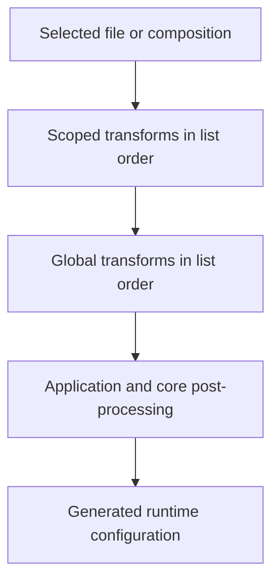

import { Badge, Steps, TabItem, Tabs } from "@astrojs/starlight/components";

Clash Nyanpasu 2.0 builds a runtime configuration from a configuration profile and its transforms. The older “proxy chain” wording refers to this profile transformation workflow. A transform reads the result produced so far and passes its output to the next step; it does not rewrite the source profile.

## Concepts

A **configuration profile** is a file profile or a composition profile that can be selected for use. A **transform profile** is a reusable operation and cannot be activated on its own.

Clash Nyanpasu provides three transform types <Badge text="3 transform types" variant="note" />:

- **YAML overlay** (shown as **Merge** on some existing profiles) applies declarative merge rules.
- **JavaScript** runs a script against the current configuration object.
- **Lua** runs a script against the current configuration table.

:::note[The older pipeline proposal]
The previously proposed standalone `pipeline` transform is not a separate transform type in 2.0. Build a pipeline by ordering scoped and global YAML, JavaScript, or Lua transforms.
:::

## Configure a transform chain

<Steps>

1. In **Profiles**, create a transform by choosing **Merge (YAML)**, **JavaScript**, or **Lua**. A transform can use a local file or another supported profile source.
2. Open a file or composition profile. In **Profile transforms**, move transforms from **Available** to **Enabled**.
3. Drag enabled transforms into the order you want, then apply the change.
4. To add transforms shared by the active configuration, use **Global transforms** in **Profiles** and set their order there.

</Steps>

A newly created transform is not enabled automatically. Scoped transforms run from top to bottom before global transforms, which also run from top to bottom.

For a composition profile, the app processes the optional base profile and each contributor with that file's scoped transforms. It appends contributor proxies in the order listed, then runs the composition profile's scoped transforms, followed by global transforms.



:::caution[Order and Clash Fields]
YAML overlay keys run in document order, and transform profiles run in their displayed order. The **Clash Field Filter** setting can remove optional fields after transforms: allow fields such as `dns` or `tun` there if they need to remain in the generated configuration. Application-managed listener fields may also override profile values.
:::

## YAML overlay <Badge text="YAML" variant="tip" />

The YAML source must have a mapping at its top level. Ordinary mapping keys merge recursively: nested mappings keep unspecified values, while scalars and sequences replace the matching value. A new key is added. This serves the same broad purpose as OpenClash's merge-style configuration editing; the rules below describe Nyanpasu 2.0. Overlay directives operate on dotted paths and run in the order they appear in the YAML document.

| Key                              | Effect                                                                  |
| -------------------------------- | ----------------------------------------------------------------------- |
| `append__path` / `append-path`   | Add a sequence to the end of an existing sequence.                      |
| `prepend__path` / `prepend-path` | Add a sequence to the beginning of an existing sequence.                |
| `override__path`                 | Replace the value at an existing dotted path.                           |
| `filter__path`                   | Filter or transform items in an existing sequence with Lua expressions. |

Append and prepend require a sequence as the directive value and an existing destination sequence. If the directive value is not a sequence, the path is missing, or the target is not a sequence, the operation is skipped with a warning. `override__path` also skips a missing path with a warning; it does not create one. These skipped-path warnings do not by themselves fail the candidate configuration.

<Tabs>
<TabItem label="Append a rule">

This appends one rule and keeps the existing `rules` entries. The `rules` field must already be a sequence.

```yaml
append__rules:
  - DOMAIN-SUFFIX,example.org,DIRECT
```

</TabItem>
<TabItem label="Prepend and add a group">

This adds a selectable group and places its domain rule before existing rules. Both `proxy-groups` and `rules` must already be sequences. Replace `DIRECT` with a proxy or group that exists in your configuration if the group should route through a proxy.

```yaml
append__proxy-groups:
  - name: Docs-Example
    type: select
    proxies:
      - DIRECT
prepend__rules:
  - DOMAIN-SUFFIX,example.org,Docs-Example
```

</TabItem>
</Tabs>

### Filter predicates and actions

`filter__path` requires an existing sequence. A string value is a Lua predicate evaluated once for each `item`: `true` keeps that item and `false` removes it. A filter mapping uses a `when` predicate and one action. A list of filters runs sequentially, with each operation receiving the previous operation's output.

:::caution[Filter errors]
A string predicate error logs a warning, removes the item that caused the error, and marks the transform as failed. A mapping's `when` error is treated as false, so the item is kept; an `expr` error also keeps the item. Both errors mark the transform as failed, so the candidate configuration is rejected. Missing paths, wrong sequence types, invalid filter shapes, and a `merge` target that is not a mapping are logged and skipped without marking the transform failed.
:::

<Tabs>
<TabItem label="Predicate">

Keep every proxy except Trojan proxies. The expression must return a boolean.

```yaml
filter__proxies: |
  item.type ~= 'trojan'
```

</TabItem>
<TabItem label="expr">

Use `when` to match items, then return the changed item from the Lua `expr`.

```yaml
filter__proxies:
  when: |
    item.type == 'trojan'
  expr: |
    item.port = 443
    return item
```

</TabItem>
<TabItem label="merge">

Recursively merge the supplied mapping into each matching item. An `icon` extension is core-dependent; check that the selected core supports it.

```yaml
filter__proxy-groups:
  when: |
    item.name == 'Spotify'
  merge:
    icon: "https://example.com/spotify.png"
```

</TabItem>
<TabItem label="override">

Replace the entire matching item with the supplied value.

```yaml
filter__proxy-groups:
  when: |
    item.name == 'Spotify'
  override:
    name: "Spotify"
    type: select
    proxies:
      - Proxies
      - DIRECT
      - HK
      - JP
      - SG
      - TW
      - US
```

</TabItem>
<TabItem label="remove">

The remove list accepts dotted string paths and integer indices. Remove a dotted path from each matching mapping item; `proxies.0` addresses the first entry in that item's `proxies` sequence.

```yaml
filter__proxy-groups:
  when: |
    item.name == 'Spotify'
  remove:
    - proxies.0
```

</TabItem>
<TabItem label="Chained filters">

Each list entry runs in order; this example adds an icon to two different groups.

```yaml
filter__proxy-groups:
  - when: |
      item.name == 'Spotify'
    merge:
      icon: "https://example.com/spotify.png"
  - when: |
      item.name == 'Netflix'
    merge:
      icon: "https://example.com/netflix.png"
```

</TabItem>
</Tabs>

For more cases, see the [current overlay executor examples](https://github.com/libnyanpasu/clash-nyanpasu/blob/main/backend/nyanpasu-config/src/runtime/executor/tests/overlay.rs).

## JavaScript <Badge text="Boa" variant="note" />

The JavaScript runner uses Boa and calls a default-exported function with the current configuration object. Its contract is `main(config: ClashConfig): ClashConfig`: `ClashConfig` describes the input and returned configuration; write executable JavaScript without TypeScript annotations. Like CFW Mixins or preprocessing, a transform edits a configuration and returns the result; the analogy does not imply script compatibility. The default export must return a mapping-compatible configuration, and a returned promise is awaited. If a promise remains pending for the runner's short wait window (about two seconds), the transform fails. `console.log`, `console.info`, `console.warn`, and `console.error` are captured in the step logs.

<Tabs>
<TabItem label="Append two rules">

This preserves the original two-rule example while checking that `rules` is an array before appending.

```javascript
export default function main(config) {
  const rules = ["DOMAIN-SUFFIX,google.com,PROXY", "DOMAIN,example.org,PROXY"];
  if (Array.isArray(config.rules)) {
    config.rules.push(...rules);
  } else {
    config.rules = rules;
  }
  return config;
}
```

</TabItem>
<TabItem label="Append one rule">

```javascript
export default function main(config) {
  if (Array.isArray(config.rules)) {
    config.rules.push("DOMAIN-SUFFIX,example.org,DIRECT");
  }
  return config;
}
```

</TabItem>
</Tabs>

The runner exposes selected pure Web APIs, but no general `fetch()` API. It can resolve local modules and HTTP(S) ES-module imports; downloaded modules are cached for up to 30 days. Only import remote modules you trust. See the [JavaScript runner source](https://github.com/libnyanpasu/clash-nyanpasu/blob/main/backend/nyanpasu-platform/src/enhance/script/js.rs).

## Lua <Badge text="Lua 5.4" variant="note" />

The Lua runner uses Lua 5.4 syntax and the `mlua` `ALL_SAFE` standard-library preset. It exposes the current configuration as the global `config`; the script must return a table containing a mapping. Console output is captured in the step logs.

<Tabs>
<TabItem label="Append two rules">

```lua
local rules = {
  'DOMAIN-SUFFIX,google.com,PROXY',
  'DOMAIN,example.org,PROXY',
}

if type(config.rules) ~= "table" then
  config.rules = {}
end

for _, rule in ipairs(rules) do
  table.insert(config.rules, rule)
end

return config
```

</TabItem>
<TabItem label="Append one rule">

```lua
if type(config.rules) == "table" then
  table.insert(config.rules, "DOMAIN-SUFFIX,example.org,DIRECT")
end

return config
```

</TabItem>
</Tabs>

See the [Lua runner source](https://github.com/libnyanpasu/clash-nyanpasu/blob/main/backend/nyanpasu-platform/src/enhance/script/lua/mod.rs). For examples that add rule sets or proxy-group icons, see [profile transform examples](../chains/loyalsoldier-rules) and [the icon example](../chains/proxy-group-icons); some fields in these examples depend on the selected core.

## Inspect and recover

<Steps>

1. Open **Inspect** from the **Profiles** sidebar.
2. Switch between **Latest build** and **Applied to core**. The chip beside the switch shows the core and revision that was applied.
3. Choose the list or graph view. The list draws the build as a branch line and groups the steps by stage: Source, Profile transforms, Global transforms, Nyanpasu, and Result. Turn on **Only steps that changed something** to hide the steps that left the configuration as it was.
4. Select a step. **Final configuration** opens in **Output**; every other step opens in **Changes**, which shows its diff from the previous step. **Output** shows the YAML the step produced, and **Logs** shows what it logged. **Core effective configuration** is what the core reported back.
5. Search for a field name, such as `dns.nameserver`, to find the steps that touched it.

</Steps>

:::caution[Failure and snapshot behavior]
A transform error rejects the candidate configuration, leaving the last applied runtime in place; ordinary skipped-path warnings do not fail the build. The last-applied view is what the core reported as running. A generated snapshot belongs to one pipeline build and is not edit history; the inspector does not provide rollback.
:::

To discard unsaved source edits, use **Reset** in the profile editor or choose **Cancel** and confirm discarding changes. To disable a transform, move it from **Enabled** to **Available** in the scoped or global transform editor and apply the change. To undo saved content, restore the desired transform source and save it.
