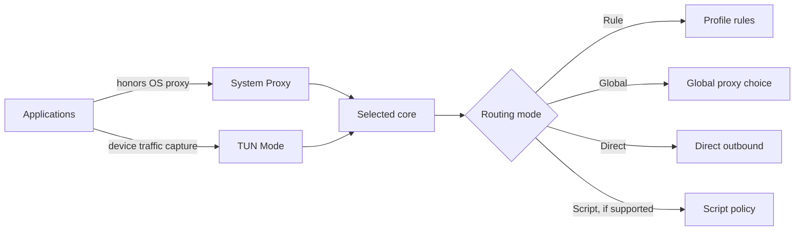

import { Aside, Badge, Steps, Tabs, TabItem } from "@astrojs/starlight/components";

Clash Nyanpasu has two ways to deliver device traffic to the selected core. A separate routing mode controls what the core does with traffic it receives.

| Setting                                                            | Role                                                                                                                                                                                                                                  |
| ------------------------------------------------------------------ | ------------------------------------------------------------------------------------------------------------------------------------------------------------------------------------------------------------------------------------- |
| **System Proxy** <Badge text="OS proxy settings" variant="note" /> | Sets the operating system's proxy. Only applications that honor those settings use it.                                                                                                                                                |
| **TUN Mode** <Badge text="Virtual interface" variant="caution" />  | Writes the TUN setting to the active core configuration so the core can create a virtual interface and route device traffic. It can cover applications that ignore the system proxy, subject to core support and network permissions. |
| **Routing Mode** <Badge text="Core policy" variant="tip" />        | Selects how the core routes captured traffic. It does not turn System Proxy or TUN on.                                                                                                                                                |

## Choose how traffic reaches the core

Start with **System Proxy** for browsers and other applications that follow the operating system's proxy settings. It is the simplest starting point and does not need TUN network privileges, but apps with their own proxy or network settings may bypass it.

Use **TUN Mode** when you need to capture traffic from applications that ignore the system proxy. Nyanpasu writes the TUN setting to the active core configuration; the selected core then creates a virtual interface and changes device-level routing. Both core support and sufficient network permissions matter. System Proxy and TUN are independent switches and can both be enabled; start with one when diagnosing which traffic is covered.

Both switches and the routing selector are in **Settings → System Settings**. The **Current System Proxy** section on that page shows the proxy settings reported by the operating system. It is a useful check of the OS setting, but does not prove that a particular app uses it.

<Aside type="note" title="System Proxy Guard">
  If another application keeps changing the OS proxy, enable **System Proxy Guard** in **Settings →
  System Settings**. It monitors the setting and reapplies Nyanpasu's proxy configuration when it
  changes.
</Aside>

## Rule, Global, and Direct

These modes apply to traffic handled by the core, regardless of whether it arrived through System Proxy or TUN:

| Mode       | What it does                                                                                                                      |
| ---------- | --------------------------------------------------------------------------------------------------------------------------------- |
| **Rule**   | Applies the profile's rules to choose an outbound, such as a proxy group or a direct connection. This is the usual starting mode. |
| **Global** | Sends handled traffic through the core's global proxy choice. Select a usable proxy or proxy group in the profile.                |
| **Direct** | Sends handled traffic directly, without using a proxy outbound.                                                                   |

With **Clash Premium**, the selector may also offer **Script** mode. Other cores may not provide this mode; see [core compatibility](./cores-and-compatibility).

## Enable TUN with the system service

<Badge text="Core-dependent" variant="caution" /> TUN requires the selected core to support the
configuration and TUN stack your setup uses. If the option is unavailable or the core rejects the
configuration, check [core compatibility](./cores-and-compatibility).

<Steps>

1. Open **Settings → System Settings** and find **System Service**. Select **Install**, then **Start** if the service is stopped. The operating system asks for elevated authorization; see the platform tabs below.
2. After the service is installed, compatible, and running, turn on **Service Mode**. This lets the app manage the core through the service, which grants the core the privileges needed for features such as TUN.
3. Turn on **TUN Mode** under the **Routing Mode** section. Check the service status and any warning beside Service Mode before testing traffic.

</Steps>

### Authorization by platform

<Tabs>
<TabItem label="Windows">

Installing or starting the service uses an elevated helper. If a service is installed but incompatible, follow the message in **System Service** to reinstall a compatible service version.

</TabItem>
<TabItem label="macOS">

Installing or starting the service requests administrator authorization through the app. Approve the system prompt to complete the operation. The service runs in the system launchd domain.

</TabItem>
<TabItem label="Linux">

Installing or starting the service uses the app's elevated service helper. Package and architecture availability varies; see the [installation guide](./install).

</TabItem>
</Tabs>

<Aside type="caution" title="Service Mode can fall back to local execution">
  If the service is missing, stopped, incompatible, or unable to run the core, Nyanpasu falls back
  to a locally running core. The Service Mode switch can remain enabled while this happens. The
  local core only has the permissions of its launch environment, so TUN may fail. Check the warning
  beside **Service Mode** and the status in **System Service**; an enabled TUN switch alone does not
  confirm elevated execution.
</Aside>

The service is designed to give the core the privileges needed for system-level features while keeping the desktop app at the user's normal permission level. **TUN Stack** under **Settings → Clash Settings** offers **System**, **gVisor**, and **Mixed** where supported by the selected core. **Mixed** is not offered with Clash Premium. Do not assume every stack or optional TUN field works across all cores.

Manual changes to core-binary permissions are not part of the app's TUN setup flow; use **System Service** and **Service Mode** instead.

## Check that it is working

- For **System Proxy**, inspect **Current System Proxy** and test an application that follows OS proxy settings.
- For **TUN**, confirm **TUN Mode** is on. If using Service Mode, verify that **System Service** is running and no fallback warning is shown. Then test an application that ignores the system proxy.
- If traffic reaches the core but takes the wrong route, check the profile rules and selected **Routing Mode**.

An enabled switch shows the requested setting; it does not prove that every application sends traffic through the core.

## Turn the modes off

- Turn **System Proxy** off to disable the proxy setting Nyanpasu applied. When the app exits, it attempts to restore the system proxy state captured before it took control.
- Turn **TUN Mode** off to apply a core configuration with TUN disabled. Service Mode can stay enabled independently.
- Select **Rule** to return the core to profile-based routing after using Global, Direct, or Script mode.

See the [installation guide](./install) for platform and package information, the [core guide](./cores-and-compatibility) for core-specific behavior, and the [FAQ](../others/faq) for troubleshooting.
