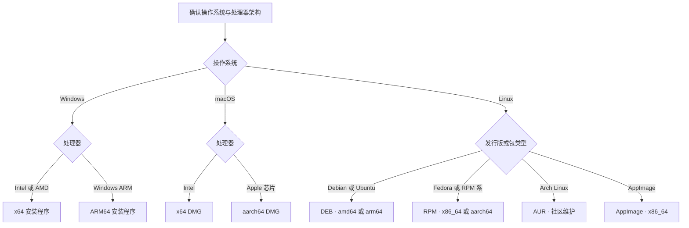

import { Badge, Steps, Tabs, TabItem } from "@astrojs/starlight/components";

<Badge text="Windows · x64 / ARM64" />
<Badge text="macOS · Intel / Apple 芯片" />
<Badge text="Linux · DEB / RPM / AppImage" />
<Badge text="原生多内核支持" variant="success" />

Clash Nyanpasu 支持 Windows 10 及更高版本、macOS 12.6 及更高版本，以及 `glibc >= 2.39` 的 Linux。请从官方 [releases](https://github.com/LibNyanpasu/clash-nyanpasu/releases) 页面选择适用于设备的安装包；各版本提供的包型和处理器架构可能不同。

:::note[处理器架构名称]

<code>x64</code>、<code>amd64</code> 和 <code>x86_64</code> 表示 64 位 Intel/AMD 架构；<code>ARM64</code> 和 <code>aarch64</code> 表示 64 位 Arm 架构，包括 Apple 芯片及受支持的 Windows 或 Linux 设备。目前仅支持这些 64 位架构，不支持 32 位或较旧的 Arm 设备。

:::

:::caution[已归档且不再受支持的版本]

Clash Nyanpasu 1.6.x 及更早版本已完全归档且不再受支持，不再维护或修复问题；请勿用于新安装。

:::

## 选择安装包



<Steps>

1. **确认处理器架构。** Windows 用户打开**设置 → 系统 → 关于**，查看“系统类型”；macOS 用户打开**苹果菜单 → 关于本机**；Linux 用户可在终端运行 `uname -m`。
2. **根据文件名后缀选择安装包。** `x64`、`amd64` 和 `x86_64` 表示 64 位 Intel/AMD 架构；`ARM64` 和 `aarch64` 表示 64 位 Arm 架构。发布页不一定为每种架构提供所有包型。
3. **安装并继续完成[首次连接](./first-connection)。** Linux 用户还应阅读下方对应包型的说明。

</Steps>

:::note[内置代理内核]

Clash Nyanpasu 原生支持 Clash Premium、Mihomo、Clash Rust 和 Meow 内核系列，并在可用时提供稳定版与 Alpha 选项。官方发布包会附带受支持的内核程序。配置中使用的功能未必被所有内核实现，请参阅[内核选择与兼容性](./cores-and-compatibility)。

:::

## Windows

<Badge text="Windows 10 及更高版本" />
<Badge text="x64" />
<Badge text="ARM64" />

大多数 Intel/AMD 电脑下载文件名以 `_x64-setup.exe` 结尾的安装程序；Windows on ARM 下载 `_arm64-setup.exe`。

:::note[WebView2 运行时]

标准安装程序使用 Microsoft WebView2 Bootstrapper。如果系统尚未安装 WebView2 Runtime，安装程序可以协助安装；此过程可能需要联网。也可以先从 [Microsoft 官方网站](https://developer.microsoft.com/zh-cn/microsoft-edge/webview2)单独安装 WebView2 Runtime。

如果希望随应用一起安装 WebView2 Runtime，请选择文件名中带 `fixed-webview` 的较大安装包，例如 `_fixed-webview-x64-setup.exe` 或 `_fixed-webview-arm64-setup.exe`。

:::

### 便携版压缩包

Windows 版本还提供 `_x86_64_portable.zip` 和 `_aarch64_portable.zip`。解压后运行应用程序即可。另有包含 WebView2 Runtime 的 Fixed-WebView 便携版。

:::caution[便携版说明]

标准便携版不包含 WebView2，因此系统中必须已安装该运行时。便携版的设置和数据保存在解压目录旁的 `.config/` 和 `.data/` 中；请确保该目录可写，移动或备份时也要保持目录完整。

压缩包包含 <code>nyanpasu-service.exe</code>；安装或启动服务时会请求提升权限并注册 Windows 系统服务。应用启动时，深层链接处理程序还会为当前用户注册 <code>clash:</code> 和 <code>clash-nyanpasu:</code> URL 方案，因此便携版仍可能修改系统状态。便携版的 Windows 系统通知会以应用对话框显示。便携版不使用应用内的应用更新功能；升级时请手动下载较新的便携包。

:::

## macOS

<Badge text="macOS 12.6 及更高版本" />
<Badge text="Intel · x64" />
<Badge text="Apple 芯片 · aarch64" />

Intel Mac 下载文件名以 `_x64.dmg` 结尾的磁盘映像；Apple 芯片 Mac 下载 `_aarch64.dmg`。打开磁盘映像后，将 Clash Nyanpasu 拖到“应用程序”目录。如果安装失败，请参阅[常见问题](../others/faq)。

## Linux

官方 Linux 安装包会随版本变化。目前的包型包括 `amd64` 和 `arm64` 的 DEB、`x86_64` 和 `aarch64` 的 RPM，以及 `amd64` AppImage。当前尚未发布 ARM64 AppImage。

<Tabs>
  <TabItem label="Debian / Ubuntu · DEB">

下载文件名以 `_amd64.deb` 或 `_arm64.deb` 结尾的安装包，然后在下载目录中安装：

```bash
sudo apt install ./Clash.Nyanpasu_*_amd64.deb
```

ARM64 设备使用：

```bash
sudo apt install ./Clash.Nyanpasu_*_arm64.deb
```

以上通配符要求当前目录中只有一个符合条件的版本安装包。

  </TabItem>
  <TabItem label="Fedora · RPM">

下载文件名以 `.x86_64.rpm` 或 `.aarch64.rpm` 结尾的 RPM 包，然后使用 DNF 安装：

```bash
sudo dnf install ./Clash.Nyanpasu-*.x86_64.rpm
```

ARM64 设备使用：

```bash
sudo dnf install ./Clash.Nyanpasu-*.aarch64.rpm
```

以上通配符要求当前目录中只有一个符合条件的版本安装包。

  </TabItem>
  <TabItem label="AppImage">

下载文件名以 `_amd64.AppImage` 结尾的文件。赋予执行权限后，可在文件管理器中双击启动，也可在终端中运行。请在下载目录中执行：

```bash
chmod +x ./Clash.Nyanpasu_*_amd64.AppImage
./Clash.Nyanpasu_*_amd64.AppImage
```

以上通配符要求当前目录中只有一个符合条件的 AppImage。若要设置登录时自动启动，请打开**设置 → 系统 → 启动设置 → 随系统启动**。

TUN 取决于所选内核，并需要相应的网络权限。请通过**系统服务**以提升权限安装并启动服务，再开启**服务模式**和 TUN；桌面应用应以普通用户运行，不要使用 <code>sudo</code> 启动整个 AppImage。具体步骤请参阅[系统代理与 TUN](./system-proxy-tun)。

  </TabItem>
</Tabs>

如果遇到其他 AppImage 问题，请在[提交问题](https://github.com/LibNyanpasu/clash-nyanpasu/issues/new)时注明 Linux 发行版、处理器架构、应用版本和安装包类型。

### 可选：创建 AppImage 启动器和登录自启动项

应用内置的登录启动选项位于**设置 → 系统 → 启动设置 → 随系统启动**。如果手动创建桌面启动项，请将 AppImage 保存在固定的绝对路径，并将 <code>VERSION</code> 替换为实际文件名。应用菜单启动器应放在 <code>applications</code> 目录；登录自启动则使用独立的 <code>autostart</code> 目录。<code>Autostart=true</code> 不是标准的桌面条目键，<code>update-desktop-database</code> 也只刷新应用程序目录。请在应用内设置和手动自启动项中选择一种，以免应用重复启动。

<Tabs>
  <TabItem label="用户目录">

将 <code>APPIMAGE_PATH</code> 设置为 AppImage 的绝对路径。以下示例使用标准 hicolor 图标目录：

~~~bash
APPIMAGE_PATH="$HOME/Applications/Clash.Nyanpasu_VERSION_amd64.AppImage"
ICON_DIR="$HOME/.local/share/icons/hicolor/256x256/apps"
APP_DIR="$HOME/.local/share/applications"

chmod +x "$APPIMAGE_PATH"
mkdir -p "$ICON_DIR" "$APP_DIR"
curl -fL "https://raw.githubusercontent.com/libnyanpasu/clash-nyanpasu/main/frontend/nyanpasu/src/assets/image/logo-box.png" -o "$ICON_DIR/clash-nyanpasu.png"

cat > "$APP_DIR/clash-nyanpasu.desktop" <<EOF
[Desktop Entry]
Type=Application
Name=Clash Nyanpasu
Comment=Clash proxy client
Exec="$APPIMAGE_PATH" %U
Icon=clash-nyanpasu
Terminal=false
Categories=Network;
EOF

update-desktop-database "$APP_DIR"
~~~

如果还需要登录时自动启动，请在用户自启动目录创建单独的条目：

~~~bash
APPIMAGE_PATH="$HOME/Applications/Clash.Nyanpasu_VERSION_amd64.AppImage"
AUTOSTART_DIR="$HOME/.config/autostart"
mkdir -p "$AUTOSTART_DIR"

cat > "$AUTOSTART_DIR/clash-nyanpasu.desktop" <<EOF
[Desktop Entry]
Type=Application
Name=Clash Nyanpasu
Exec="$APPIMAGE_PATH"
Terminal=false
EOF
~~~

  </TabItem>
  <TabItem label="系统目录">

将 AppImage 放在所有用户都可以读取的固定路径，例如 <code>/opt/clash-nyanpasu/</code>，并将 <code>VERSION</code> 替换为实际文件名。第一条命令会从“下载”目录复制；如有需要请修改源路径。

~~~bash
APPIMAGE_PATH="/opt/clash-nyanpasu/Clash.Nyanpasu_VERSION_amd64.AppImage"
ICON_DIR="/usr/share/icons/hicolor/256x256/apps"
APP_DIR="/usr/share/applications"

sudo install -D -m 0755 "$HOME/Downloads/Clash.Nyanpasu_VERSION_amd64.AppImage" "$APPIMAGE_PATH"
sudo install -d "$ICON_DIR" "$APP_DIR"
curl -fL "https://raw.githubusercontent.com/libnyanpasu/clash-nyanpasu/main/frontend/nyanpasu/src/assets/image/logo-box.png" -o /tmp/clash-nyanpasu.png
sudo install -m 0644 /tmp/clash-nyanpasu.png "$ICON_DIR/clash-nyanpasu.png"

sudo tee "$APP_DIR/clash-nyanpasu.desktop" >/dev/null <<EOF
[Desktop Entry]
Type=Application
Name=Clash Nyanpasu
Comment=Clash proxy client
Exec="$APPIMAGE_PATH" %U
Icon=clash-nyanpasu
Terminal=false
Categories=Network;
EOF

sudo update-desktop-database "$APP_DIR"
~~~

如需为所有用户设置登录自启动，请在 <code>/etc/xdg/autostart</code> 下另建一个条目：

~~~bash
APPIMAGE_PATH="/opt/clash-nyanpasu/Clash.Nyanpasu_VERSION_amd64.AppImage"
sudo tee /etc/xdg/autostart/clash-nyanpasu.desktop >/dev/null <<EOF
[Desktop Entry]
Type=Application
Name=Clash Nyanpasu
Exec="$APPIMAGE_PATH"
Terminal=false
EOF
~~~

  </TabItem>
</Tabs>

如果系统中没有 <code>update-desktop-database</code> 命令，请安装发行版提供的 <code>desktop-file-utils</code> 软件包。

:::note[应用和内核更新]

标准 Windows 安装包、macOS 安装包和 AppImage 支持应用内的**应用更新**。Windows 便携版和 Linux DEB/RPM/AUR 包不使用该更新器：请手动下载较新的便携包，或通过系统包管理器、AUR 助手更新已安装的软件包。

受支持的代理内核可在内核管理功能中单独检查和更新。内核更新独立于桌面应用更新；具体可用性取决于所选内核，AUR 包还取决于配方声明的依赖。详见[内核选择与兼容性](./cores-and-compatibility)。

:::

### Arch Linux · AUR

<Badge text="社区维护" variant="caution" />
<Badge text="三选一安装" />

AUR 包由社区贡献者维护，不属于 Clash Nyanpasu 项目官方包。这几种包型彼此冲突，请只安装其中一种。以下版本来自 2026 年 10 月 17 日查询的 AUR RPC 记录；安装前请确认当前记录。

<Tabs>
  <TabItem label="稳定版 · 源码构建">

包名：[clash-nyanpasu](https://aur.archlinux.org/packages/clash-nyanpasu)。此包会在本机编译应用。

:::caution[已过期；不是受支持的 2.0 安装方式]

AUR 记录显示版本为 <code>1.6.1-1</code>，并标记为过期。该版本属于已归档且不再受支持的 1.6.x 系列，因此此包不能作为受支持的 2.0 安装方式。AUR 配方更新前不提供安装命令。

:::

  </TabItem>
  <TabItem label="稳定版 · 预编译二进制">

包名：[clash-nyanpasu-bin](https://aur.archlinux.org/packages/clash-nyanpasu-bin)。此包安装预编译应用，无需在本机编译。

AUR 记录显示版本为 <code>2.0.0rc.2-1</code>，对应上游 <code>2.0.0-rc.2</code>。虽然这是 AUR 中的预编译稳定版包型，但当前上游版本仍是候选版本。

~~~bash
paru -Syu clash-nyanpasu-bin
# 或
yay -Syu clash-nyanpasu-bin
~~~

  </TabItem>
  <TabItem label="开发版 · 源码构建">

包名：[clash-nyanpasu-git](https://aur.archlinux.org/packages/clash-nyanpasu-git)。此包根据 AUR 配方跟踪的源码修订版本构建。RPC 记录显示版本为 <code>2.0.0.r6931.f6538a47-3</code>（修订 <code>f6538a47</code>）；开发版本变化频繁，也可能包含问题。

~~~bash
paru -Syu clash-nyanpasu-git
# 或
yay -Syu clash-nyanpasu-git
~~~

  </TabItem>
</Tabs>

:::note[AUR 依赖和内核可用性]

AUR 配方由社区单独维护，可能使用系统内核包，与官方发布包的内核捆绑方式不同。当前 <code>clash-nyanpasu-bin</code> 配方将 Mihomo 列为依赖，并将 Clash Rust 列为可选依赖。请查看所选包的依赖列表，并参阅[内核选择与兼容性](./cores-and-compatibility)了解应用支持的内核。

:::
