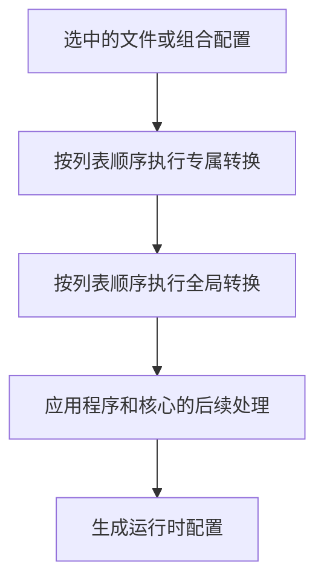

import { Badge, Steps, TabItem, Tabs } from "@astrojs/starlight/components";

Clash Nyanpasu 2.0 根据配置 Profile 及其转换生成运行时配置。旧称“代理链”指的就是这套 Profile 转换流程。每个转换都会读取当前结果，并将输出传给下一步；它不会改写配置 Profile 的源文件。

## 概念

**配置 Profile** 分为文件 Profile 和组合 Profile，可被选中使用。**转换 Profile** 是可复用的操作，不能单独启用。

Clash Nyanpasu 提供三种转换类型 <Badge text="3 种转换类型" variant="note" />：

- **YAML Overlay**（部分旧 Profile 中显示为 **Merge**）按声明式合并规则修改配置。
- **JavaScript** 使用脚本处理当前配置对象。
- **Lua** 使用脚本处理当前配置表。

:::note[关于旧版 pipeline 计划]
旧文档中提到的独立 `pipeline` 转换类型并未成为 2.0 的独立类型。请通过排序专属和全局 YAML、JavaScript 或 Lua 转换来组成处理链。
:::

## 配置转换链

<Steps>

1. 在**配置**页面创建转换，选择**合并脚本 (YAML)**、**JavaScript 脚本**或**Lua 脚本**。转换可以使用本地文件或其他受支持的 Profile 来源。
2. 打开文件或组合 Profile，在**配置转换**区域将转换从**未启用**移入**已启用**。
3. 拖动已启用的转换调整顺序，然后应用更改。
4. 若要为当前启用的配置添加共用转换，请在**配置**页面使用**全局转换**并调整其顺序。

</Steps>

新建转换后不会自动启用。专属转换按从上到下的顺序执行，然后执行全局转换；全局转换也按从上到下的顺序执行。

对于组合 Profile，应用会先处理可选基础 Profile 和每个贡献项，并执行各文件自身的专属转换。随后按列表顺序追加贡献项中的代理，再执行组合 Profile 自身的专属转换，最后运行全局转换。



:::caution[顺序与 Clash 字段]
YAML Overlay 中的键按文档顺序执行，转换 Profile 按界面中的顺序执行。**Clash 字段过滤**设置可能在转换后移除可选字段；如需保留 `dns` 或 `tun`，请在该设置中允许对应字段。应用程序管理的监听器字段也可能覆盖 Profile 中的值。
:::

## YAML Overlay <Badge text="YAML" variant="tip" />

YAML 源文件的顶层必须是映射。普通映射键会递归合并：嵌套映射中未指定的值会保留，标量和序列会替换对应值；原本不存在的键会新增。这与 OpenClash 的配置合并编辑有相似用途；下文说明的是 Nyanpasu 2.0 的具体行为。Overlay 指令可以操作点分路径，并按 YAML 文档中的顺序执行。

| 键                               | 作用                                          |
| -------------------------------- | --------------------------------------------- |
| `append__path` / `append-path`   | 将序列追加到已存在序列的末尾。                |
| `prepend__path` / `prepend-path` | 将序列添加到已存在序列的开头。                |
| `override__path`                 | 替换已存在的点分路径。                        |
| `filter__path`                   | 使用 Lua 表达式筛选或转换已存在序列中的项目。 |

追加和前置操作要求指令值为序列，并且目标字段已经存在且为序列。如果指令值不是序列、路径缺失或目标字段不是序列，该操作会记录警告并跳过。`override__path` 遇到缺失路径时也会记录警告并跳过，不会新建路径。这些路径跳过警告本身不会导致候选配置构建失败。

<Tabs>
<TabItem label="追加规则">

在原有 `rules` 序列后追加一条规则，并保留已有内容。`rules` 必须已经是序列。

```yaml
append__rules:
  - DOMAIN-SUFFIX,example.org,DIRECT
```

</TabItem>
<TabItem label="前置规则并添加代理组">

新增一个可选择的代理组，并将域名规则放在已有规则之前。`proxy-groups` 和 `rules` 都必须已经是序列。如果希望该代理组通过代理转发，请将 `DIRECT` 替换为配置中已有的代理或代理组名称。

```yaml
append__proxy-groups:
  - name: Docs-Example
    type: select
    proxies:
      - DIRECT
prepend__rules:
  - DOMAIN-SUFFIX,example.org,Docs-Example
```

</TabItem>
</Tabs>

### Filter 谓词与操作

`filter__path` 要求目标字段已经是序列。字符串值是逐项执行的 Lua 谓词，当前项通过 `item` 访问：返回 `true` 会保留该项，返回 `false` 会移除该项。Filter 映射使用 `when` 谓词和一个操作。Filter 列表会依次执行，每个操作都会处理上一步的结果。

:::caution[Filter 错误]
字符串谓词出错时会记录警告、移除发生错误的项目，并将转换标记为失败。映射中的 `when` 出错会按 false 处理，因此保留该项目；`expr` 出错也会保留项目。这两类错误都会标记转换失败，因此候选配置会被拒绝。路径缺失、序列类型错误、Filter 结构无效，以及 `merge` 目标项目不是映射时，会记录日志并跳过操作，不会标记转换失败。
:::

<Tabs>
<TabItem label="谓词筛选">

保留 Trojan 以外的代理。表达式必须返回布尔值。

```yaml
filter__proxies: |
  item.type ~= 'trojan'
```

</TabItem>
<TabItem label="expr">

先使用 `when` 匹配项目，再用 Lua `expr` 返回修改后的项目。

```yaml
filter__proxies:
  when: |
    item.type == 'trojan'
  expr: |
    item.port = 443
    return item
```

</TabItem>
<TabItem label="merge">

将映射递归合并到匹配的项目中。`icon` 扩展取决于内核支持，请确认所选内核能够识别该字段。

```yaml
filter__proxy-groups:
  when: |
    item.name == 'Spotify'
  merge:
    icon: "https://example.com/spotify.png"
```

</TabItem>
<TabItem label="override">

使用给定值整体替换匹配的项目。

```yaml
filter__proxy-groups:
  when: |
    item.name == 'Spotify'
  override:
    name: "Spotify"
    type: select
    proxies:
      - Proxies
      - DIRECT
      - HK
      - JP
      - SG
      - TW
      - US
```

</TabItem>
<TabItem label="remove">

remove 列表可以包含点分字符串路径和整数索引。它会从匹配的映射项目中删除指定路径；`proxies.0` 表示该项目 `proxies` 序列中的第一项。

```yaml
filter__proxy-groups:
  when: |
    item.name == 'Spotify'
  remove:
    - proxies.0
```

</TabItem>
<TabItem label="链式筛选">

列表中的操作会依次执行。此例为两个不同的代理组添加图标。

```yaml
filter__proxy-groups:
  - when: |
      item.name == 'Spotify'
    merge:
      icon: "https://example.com/spotify.png"
  - when: |
      item.name == 'Netflix'
    merge:
      icon: "https://example.com/netflix.png"
```

</TabItem>
</Tabs>

更多情况请参阅[当前 Overlay 执行器示例](https://github.com/libnyanpasu/clash-nyanpasu/blob/main/backend/nyanpasu-config/src/runtime/executor/tests/overlay.rs)。

## JavaScript <Badge text="Boa" variant="note" />

JavaScript 执行器使用 Boa，并调用默认导出的函数，传入当前配置对象。其约定为 `main(config: ClashConfig): ClashConfig`：`ClashConfig` 用来说明输入和返回配置的类型；实际脚本请写可执行的 JavaScript，不要添加 TypeScript 类型标注。与 CFW Mixins 或预处理类似，转换会修改配置并返回结果；此类比不代表脚本兼容。默认导出必须返回可转换为配置映射的结果；执行器会等待返回的 Promise。如果 Promise 在执行器的短等待时间（约两秒）内仍未完成，转换会失败。`console.log`、`console.info`、`console.warn` 和 `console.error` 会记录在步骤日志中。

<Tabs>
<TabItem label="追加两条规则">

保留原有的两条规则示例，并在追加前确认 `rules` 是数组。

```javascript
export default function main(config) {
  const rules = ["DOMAIN-SUFFIX,google.com,PROXY", "DOMAIN,example.org,PROXY"];
  if (Array.isArray(config.rules)) {
    config.rules.push(...rules);
  } else {
    config.rules = rules;
  }
  return config;
}
```

</TabItem>
<TabItem label="追加一条规则">

```javascript
export default function main(config) {
  if (Array.isArray(config.rules)) {
    config.rules.push("DOMAIN-SUFFIX,example.org,DIRECT");
  }
  return config;
}
```

</TabItem>
</Tabs>

执行器只提供部分纯 Web API，不提供通用的 `fetch()`。它可以解析本地模块和 HTTP(S) ES 模块导入；下载的模块最多缓存 30 天。请只导入可信的远程模块。详见 [JavaScript 执行器源码](https://github.com/libnyanpasu/clash-nyanpasu/blob/main/backend/nyanpasu-platform/src/enhance/script/js.rs)。

## Lua <Badge text="Lua 5.4" variant="note" />

Lua 执行器使用 Lua 5.4 语法和 `mlua` 的 `ALL_SAFE` 标准库预设。当前配置通过全局变量 `config` 提供；脚本必须返回一个包含映射的表。控制台输出会记录在步骤日志中。

<Tabs>
<TabItem label="追加两条规则">

```lua
local rules = {
  'DOMAIN-SUFFIX,google.com,PROXY',
  'DOMAIN,example.org,PROXY',
}

if type(config.rules) ~= "table" then
  config.rules = {}
end

for _, rule in ipairs(rules) do
  table.insert(config.rules, rule)
end

return config
```

</TabItem>
<TabItem label="追加一条规则">

```lua
if type(config.rules) == "table" then
  table.insert(config.rules, "DOMAIN-SUFFIX,example.org,DIRECT")
end

return config
```

</TabItem>
</Tabs>

详见 [Lua 执行器源码](https://github.com/libnyanpasu/clash-nyanpasu/blob/main/backend/nyanpasu-platform/src/enhance/script/lua/mod.rs)。添加规则集或代理组图标的完整示例请参阅[配置转换示例](./chains/loyalsoldier-rules)和[图标示例](./chains/proxy-group-icons)；其中部分字段取决于所选内核。

## 检查和恢复

<Steps>

1. 在**配置**页面打开**配置检查**。
2. 切换查看**已生成配置**或**上次应用的快照**。
3. 选择列表或流程图视图，再选择某一步查看其 YAML 输出、与父步骤的差异、变更字段和步骤日志。

</Steps>

:::caution[失败与快照]
转换出错会使候选配置被拒绝，当前已应用的运行时配置会继续使用；普通的路径跳过警告不会导致构建失败。上次应用视图显示核心报告为正在运行的配置。生成快照属于某次处理链构建，不是编辑历史；检查器不提供回滚操作。
:::

若要放弃尚未保存的源文件修改，请在 Profile 编辑器点击**重置**，或点击**取消**并确认放弃修改。若要停用转换，请在专属或全局转换编辑器中将其从**已启用**移回**未启用**并应用更改。若要撤销已保存的内容，请恢复所需转换源文件并保存。
