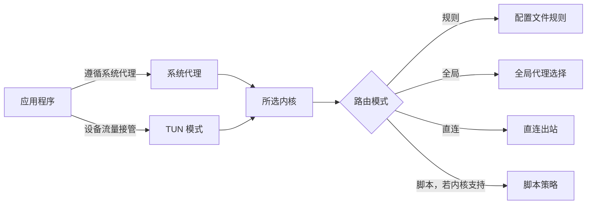

import { Aside, Badge, Steps, Tabs, TabItem } from "@astrojs/starlight/components";

Clash Nyanpasu 提供两种将设备流量交给所选内核处理的方式。路由模式则单独决定内核收到流量后如何处理。

- **系统代理** <Badge text="操作系统代理设置" variant="note" />：设置操作系统代理，只有遵循这些设置的应用程序才会使用。
- **TUN 模式** <Badge text="虚拟网络接口" variant="caution" />：将 TUN 设置写入当前内核配置，由内核创建虚拟网络接口并路由设备流量。它可以覆盖忽略系统代理的应用程序，但仍取决于内核支持和网络权限。
- **路由模式** <Badge text="内核策略" variant="tip" />：决定内核如何路由已接管的流量，不会自动开启系统代理或 TUN。

## 选择流量进入内核的方式

如果你使用的浏览器或其他应用遵循操作系统代理设置，可以先启用**系统代理**。这是最简单的起点，也不需要 TUN 网络权限；但使用独立代理或网络设置的应用程序可能会绕过系统代理。

如果需要接管忽略系统代理的应用程序流量，可以使用 **TUN 模式**。Nyanpasu 会将 TUN 设置写入当前内核配置，由所选内核创建虚拟网络接口并改变设备级路由，因此需要内核支持和足够的网络权限。系统代理和 TUN 是独立开关，也可以同时启用；排查流量覆盖范围时，可以先启用其中一种。

这两个开关和路由模式选择器位于**设置 → 系统设置**。该页面的**当前系统代理**区域会显示操作系统报告的代理设置，可用来检查系统代理状态，但不能证明某个应用确实使用了它。

<Aside type="note" title="系统代理守卫">
  如果其他应用经常修改操作系统代理，可在**设置 →
  系统设置**中开启**系统代理守卫**。它会监控代理设置，并在设置变化时重新应用 Nyanpasu 的代理配置。
</Aside>

## 规则、全局与直连

这些模式适用于内核处理的流量，无论流量来自系统代理还是 TUN：

| 模式     | 作用                                                                         |
| -------- | ---------------------------------------------------------------------------- |
| **规则** | 根据配置文件中的规则选择出站方式，例如代理组或直连。这通常是推荐的起始模式。 |
| **全局** | 将已接收的流量交给内核的全局代理选择。请在配置文件中选择可用的代理或代理组。 |
| **直连** | 将已接收的流量直接发送，不使用代理出站。                                     |

选择 **Clash Premium** 内核时，选择器还可能显示**脚本**模式；其他内核可能不提供该模式。详情请查看[内核兼容性](./cores-and-compatibility)。

## 通过系统服务启用 TUN

<Badge text="依赖所选内核" variant="caution" /> TUN 要求所选内核支持当前配置和所用 TUN
堆栈。如果选项不可用或内核拒绝配置，请查看[内核兼容性](./cores-and-compatibility)。

<Steps>

1. 打开**设置 → 系统设置**，找到**系统服务**。点击**安装**；如果服务已停止，再点击**启动**。操作系统会请求提升权限，授权方式见下方平台标签。
2. 确认服务已安装、兼容并运行后，开启**服务模式**。应用会通过系统服务管理内核，由服务向内核提供 TUN 等功能所需的权限。
3. 在**路由模式**区域开启 **TUN 模式**。测试流量前，先确认系统服务状态正常，且服务模式旁没有回退警告。

</Steps>

### 各平台授权方式

<Tabs>
<TabItem label="Windows">

安装或启动服务时会调用提权辅助程序。如果已安装的服务不兼容，请按**系统服务**区域的提示重新安装兼容版本。

</TabItem>
<TabItem label="macOS">

通过应用安装或启动服务时会请求管理员授权。请在系统弹出的授权窗口中确认。服务运行在系统 launchd 域中。

</TabItem>
<TabItem label="Linux">

安装或启动服务时会调用应用的提权辅助程序。不同安装包支持的平台和架构可能不同，请查看[安装指南](./install)。

</TabItem>
</Tabs>

<Aside type="caution" title="服务模式可能回退到本地运行">
  如果服务未安装、已停止、版本不兼容或无法启动内核，Nyanpasu
  会回退为本地运行内核。此时服务模式开关可能仍处于开启状态。本地内核只能使用启动环境提供的权限，因此
  TUN 可能无法启动。请检查**服务模式**旁的警告和**系统服务**状态；TUN
  开关显示开启，并不能证明内核正在以提升权限运行。
</Aside>

系统服务的设计目标是只向内核提供系统级功能所需的权限，并让桌面应用保持普通用户权限。**设置 → Clash 设置**中的**TUN 堆栈**会按所选内核提供 **System**、**gVisor** 和 **Mixed** 等选项；Clash Premium 不提供 **Mixed**。不要假设所有内核都支持相同的堆栈和可选 TUN 字段。手动修改内核二进制文件权限不属于应用内置的 TUN 设置流程；请使用**系统服务**和**服务模式**。

## 确认是否生效

- 使用**系统代理**时，检查**当前系统代理**，并用遵循操作系统代理设置的应用程序测试。
- 使用 **TUN** 时，确认 **TUN 模式**已开启。如果依赖服务模式，请确认**系统服务**正在运行且没有回退警告，然后用一个不遵循系统代理的应用程序测试。
- 如果流量已进入内核但路由不符合预期，请检查配置文件中的规则和所选**路由模式**。

开关处于启用状态只表示已请求该设置，不能证明每个应用程序的流量都经过内核。

## 关闭模式

- 关闭**系统代理**即可停用 Nyanpasu 设置的系统代理。应用退出时会尝试恢复接管系统代理之前记录的状态。
- 关闭 **TUN 模式**即可应用 TUN 已禁用的内核配置。服务模式可以独立保持开启。
- 使用全局、直连或脚本模式后，选择**规则**即可恢复按配置文件规则路由。

平台和安装包信息请查看[安装指南](./install)，内核相关行为请查看[内核兼容性](./cores-and-compatibility)，其他问题请查看[常见问题](../others/faq)。
